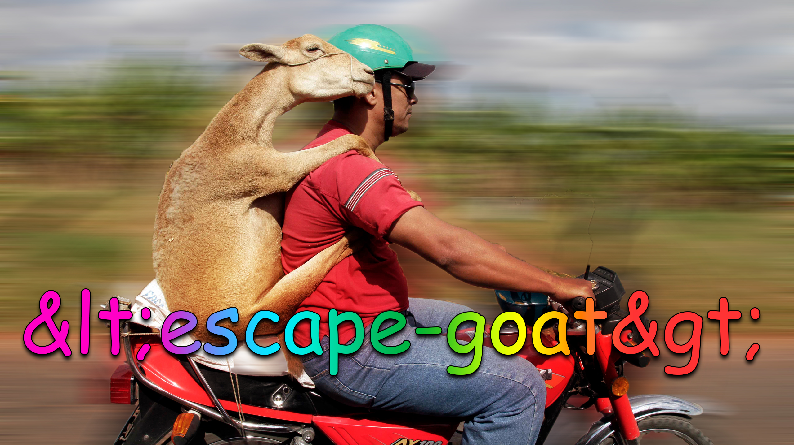

<h1>
	
</h1>

> Escape a string for use in HTML or the inverse

## Install

```sh
npm install escape-goat
```

## Usage

```js
import {htmlEscape, htmlUnescape} from 'escape-goat';

htmlEscape('🦄 & 🐐');
//=> '🦄 &amp; 🐐'

htmlUnescape('🦄 &amp; 🐐');
//=> '🦄 & 🐐'

htmlEscape('Hello <em>World</em>');
//=> 'Hello &lt;em&gt;World&lt;/em&gt;'

const url = 'https://sindresorhus.com?x="🦄"';

htmlEscape`<a href="${url}">Unicorn</a>`;
//=> '<a href="https://sindresorhus.com?x=&quot;🦄&quot;">Unicorn</a>'

const escapedUrl = 'https://sindresorhus.com?x=&quot;🦄&quot;';

htmlUnescape`URL from HTML: ${escapedUrl}`;
//=> 'URL from HTML: https://sindresorhus.com?x="🦄"'
```

## API

### htmlEscape(string)

Escapes the following characters in the given `string` argument: `&` `<` `>` `"` `'`

The function also works as a [tagged template literal](https://developer.mozilla.org/en/docs/Web/JavaScript/Reference/Template_literals#Tagged_template_literals) that escapes interpolated values.

**Note:** This method of escaping is only safe when inserting data into normal tags like `body`, `div`, `p`, `b`, `td`, etc. Inserting `htmlEscape`'d data into tags like `script` and `style` **opens your app to [XSS vulnerabilities](https://cheatsheetseries.owasp.org/cheatsheets/Cross_Site_Scripting_Prevention_Cheat_Sheet.html#rule-0-never-insert-untrusted-data-except-in-allowed-locations)**.

### htmlUnescape(htmlString)

Unescapes the following HTML entities in the given `htmlString` argument: `&amp;` `&lt;` `&gt;` `&quot;` `&#39;`

The function also works as a [tagged template literal](https://developer.mozilla.org/en/docs/Web/JavaScript/Reference/Template_literals#Tagged_template_literals) that unescapes interpolated values.

## Tip

Ensure you always quote your HTML attributes to prevent possible [XSS](https://en.wikipedia.org/wiki/Cross-site_scripting).

## FAQ

### Why yet another HTML escaping package?

I couldn't find one I liked that was tiny, well-tested, and had both escape and unescape methods.
